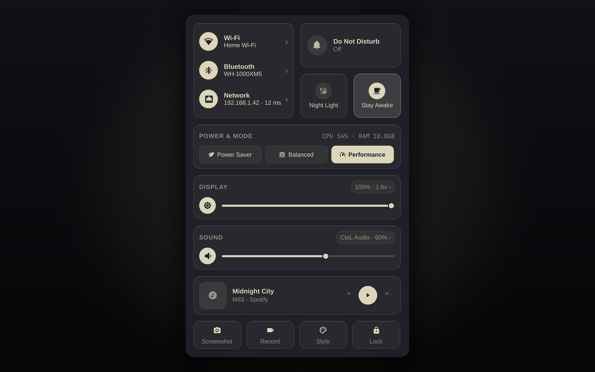

# Control Center

A macOS-inspired **Control Center** for the [Omarchy](https://omarchy.org) shell (`omarchy-shell` / Quickshell). It opens as a Bento-style popup from the bar and keeps Omarchy's native palette, typography and corner radii.

> Marketplace ID: `io.github.culcat.control-center`



## Features

- **Bar button** with a macOS-style two-switch glyph.
  - **Left click** — open or close the Control Center.
  - **Right click** — mute/unmute the output.
  - **Mouse wheel** — adjust volume and show the system OSD.
- **Connectivity card (2×2 Bento, left)**
  - **Wi-Fi** — toggle the radio, pick a network, enter a password and switch DNS providers (`DHCP`, `Cloudflare`, `Google`).
  - **Bluetooth** — toggle the adapter and manage connected, paired and discovered devices, with search and battery level.
  - **VPN & network** — shows the active tunnel (`amn0`, `tun*`, `wg*`, `tailscale*`), local IP and ping.
- **Quick toggles (Bento tiles, right)**
  - **Do Not Disturb** — synced with the Omarchy notification service.
  - **Night Light** — controls `hyprsunset` colour temperature.
  - **Stay Awake** — overrides the Omarchy idle screensaver and lock.
- **Power & telemetry**
  - Segmented power-profile switch (Power Saver, Balanced, Performance).
  - Live CPU, RAM and battery telemetry (UPower).
- **Display & Sound** (with drill-down pages)
  - Brightness slider, monitor scale presets (`1x`, `1.25x`, `1.6x`, `2x`) and interface font size (`10–20 px`).
  - Volume slider, output-device picker, microphone controls and a per-application PipeWire mixer.
- **Now Playing**
  - MPRIS album art, title and artist, player switching and Prev / Play-Pause / Next.
- **Quick actions footer**
  - Screenshot, screen recording, Style/Theme menu and lock screen.
- **Localization**
  - English, Russian, Ukrainian, German, Spanish, French and Simplified Chinese, with automatic system-locale detection and a manual override.

## Requirements

- **Omarchy Quattro** with `omarchy-shell` 4.x or newer (developed against 4.0.6).
- **Hyprland**, **PipeWire**, **NetworkManager**, **BlueZ**, **UPower** and **MPRIS** support.
- Optional hardware/services used when present: `hyprsunset` (Night Light) and a Bluetooth adapter.
- Omarchy helper commands on `PATH`:
  `omarchy-audio-output-set-default`, `omarchy-audio-input-set-default`,
  `omarchy-audio-output-sink`, `omarchy-bluetooth-device`,
  `omarchy-brightness-display`, `omarchy-capture-screenshot`, `omarchy-display-text-size`,
  `omarchy-dns`, `omarchy-hyprland-monitor-scaling`, `omarchy-menu`,
  `omarchy-monitor-state`, `omarchy-network-status`, `omarchy-powerprofiles-list`,
  `omarchy-powerprofiles-set`, `omarchy-screenrecord`, `omarchy-shell`,
  `omarchy-system-lock`, `omarchy-system-stats`.
  These ship with Omarchy; the plugin does not install anything and does not require `sudo`.

## Install

### With the Omarchy plugin manager

```bash
omarchy plugin add https://github.com/culcat/ControlCenter.git --enable
```

### Manually

```bash
git clone https://github.com/culcat/ControlCenter.git \
  ~/.config/omarchy/plugins/io.github.culcat.control-center
omarchy-shell shell rescanPlugins
omarchy plugin enable io.github.culcat.control-center
```

The widget appears in the right bar section. Move it with:

```bash
omarchy bar move io.github.culcat.control-center --section right
```

## Usage

Click the bar button to open the panel. Use the cards to drill into Wi-Fi, Bluetooth, Sound and Display pages; press **Escape** or the **Back** button to return to the main view and close the panel.

IPC targets are also available for hotkeys in `~/.config/hypr/bindings.lua`:

```bash
# Open / close the Control Center
omarchy-shell shell toggle io.github.culcat.control-center

# Open a specific page (main | wifi | bluetooth | audio | display)
omarchy-shell io.github.culcat.control-center openPage audio
```

## Configure

Settings are inline fields on the widget entry in `~/.config/omarchy/shell.json`:

```json
{
  "id": "io.github.culcat.control-center",
  "showMediaAlways": true,
  "language": "auto"
}
```

| Setting | Default | Description |
| --- | --- | --- |
| `showMediaAlways` | `true` | Keep the Now Playing card visible when no player is active. |
| `language` | `"auto"` | UI language: `auto`, `en`, `ru`, `uk`, `de`, `es`, `fr`, `zh`. |

`auto` follows `LC_ALL`, `LC_MESSAGES`, `LANG` and the Qt locale, in that order, and falls back to English.

### Localization

Translations live in [`i18n.js`](i18n.js). To add a language, copy the `en` dictionary under a new lowercase locale key, translate the values, and use the same key in the `language` setting. Placeholders such as `{0}` must stay intact.

## Remove

```bash
omarchy plugin remove io.github.culcat.control-center
```

or delete `~/.config/omarchy/plugins/io.github.culcat.control-center` and run `omarchy-shell shell rescanPlugins`.

## License

[MIT](LICENSE) © 2026 Aleksandr (culcat)

Русская документация: [README.ru.md](README.ru.md)
