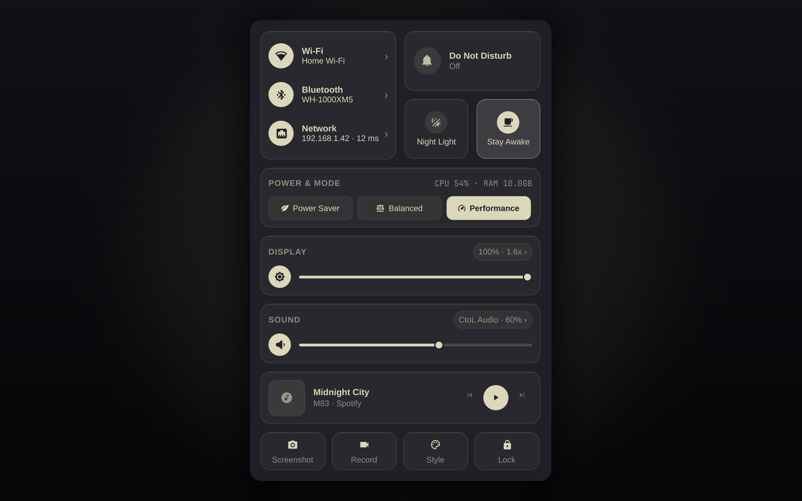

# Control Center

Плагин **Control Center** для оболочки [Omarchy](https://omarchy.org) (`omarchy-shell` / Quickshell) в духе macOS Control Center (Bento-сетка) с сохранением системной палитры, типографики и скруглений активной темы Omarchy.

> ID в маркетплейсе: `io.github.culcat.control-center`



## Возможности

- **Иконка на верхней панели**:
  - **ЛКМ** — открыть/закрыть Control Center.
  - **ПКМ** — быстрое выключение/включение звука (Mute).
  - **Колёсико мыши** — регулировка громкости с вызовом системного OSD.
- **Связь и сеть (Bento-карточка 2×2 слева)**:
  - **Wi-Fi**: включение/выключение, выбор сети, ввод пароля, переключение DNS (`DHCP`, `Cloudflare`, `Google`).
  - **Bluetooth**: включение адаптера, подключённые, сопряжённые и доступные устройства, поиск и индикация заряда.
  - **VPN и сеть**: активный туннель (`amn0`, `tun*`, `wg*`, `tailscale*`), локальный IP и пинг.
- **Быстрые переключатели**:
  - **Не беспокоить (DND)** — синхронизация с сервисом уведомлений Omarchy.
  - **Ночной свет** — управление цветовой температурой (`hyprsunset`).
  - **Не спать** — блокировка скринсейвера и локскрина (`omarchy.idle`).
- **Питание и телеметрия**:
  - Профили питания (`Экономия`, `Баланс`, `Максимум`).
  - Загрузка `CPU`, `RAM` и заряд батареи (`UPower`).
- **Экран и Звук**:
  - Яркость, масштаб монитора (`1x`, `1.25x`, `1.6x`, `2x`), размер шрифта интерфейса (`10–20 px`).
  - Громкость, устройство вывода, микрофон и микшер отдельных приложений (PipeWire).
- **Медиаплеер (Now Playing)**: обложка, название, исполнитель, переключение плееров, `Prev` / `Play-Pause` / `Next`.
- **Нижняя панель**: скриншот, запись экрана, стиль/тема, блокировка.
- **Локализация**: английский, русский, украинский, немецкий, испанский, французский и китайский (упрощённый), с автоопределением языка системы и ручным переключением.

## Требования

- **Omarchy Quattro** с `omarchy-shell` 4.x или новее (разработано на 4.0.6).
- **Hyprland**, **PipeWire**, **NetworkManager**, **BlueZ**, **UPower**, **MPRIS**.
- Опционально: `hyprsunset` и Bluetooth-адаптер.
- Системные команды Omarchy в `PATH` (поставляются с Omarchy, устанавливать ничего не нужно):
  `omarchy-audio-output-set-default`, `omarchy-audio-input-set-default`,
  `omarchy-audio-output-sink`, `omarchy-bluetooth-device`,
  `omarchy-brightness-display`, `omarchy-capture-screenshot`, `omarchy-display-text-size`,
  `omarchy-dns`, `omarchy-hyprland-monitor-scaling`, `omarchy-menu`,
  `omarchy-monitor-state`, `omarchy-network-status`, `omarchy-powerprofiles-list`,
  `omarchy-powerprofiles-set`, `omarchy-screenrecord`, `omarchy-shell`,
  `omarchy-system-lock`, `omarchy-system-stats`.

## Установка

### Через менеджер плагинов Omarchy

```bash
omarchy plugin add https://github.com/culcat/ControlCenter.git --enable
```

### Вручную

Склонируйте `https://github.com/culcat/ControlCenter` в
`~/.config/omarchy/plugins/io.github.culcat.control-center`, затем пересканируйте и включите плагин:

```bash
omarchy-shell shell rescanPlugins
omarchy plugin enable io.github.culcat.control-center
```

Виджет появится в правой секции панели. Переместить:

```bash
omarchy bar move io.github.culcat.control-center --section right
```

## Использование

Нажмите на иконку в панели. Карточки открывают страницы Wi-Fi, Bluetooth, Звук и Экран. **Escape** или кнопка **Назад** возвращают на главный экран.

IPC для хоткеев в `~/.config/hypr/bindings.lua`:

```bash
# Открыть / закрыть Control Center
omarchy-shell shell toggle io.github.culcat.control-center

# Открыть нужный раздел (main | wifi | bluetooth | audio | display)
omarchy-shell io.github.culcat.control-center openPage audio
```

## Настройки

Параметры задаются прямо в записи виджета в `~/.config/omarchy/shell.json`:

```json
{
  "id": "io.github.culcat.control-center",
  "showMediaAlways": true,
  "language": "auto"
}
```

| Параметр | По умолчанию | Описание |
| --- | --- | --- |
| `showMediaAlways` | `true` | Всегда показывать карточку медиаплеера. |
| `language` | `"auto"` | Язык интерфейса: `auto`, `en`, `ru`, `uk`, `de`, `es`, `fr`, `zh`. |

`auto` определяет язык по `LC_ALL`, `LC_MESSAGES`, `LANG` и локали Qt; если язык не найден, используется английский.

### Локализация

Переводы находятся в [`i18n.js`](i18n.js). Чтобы добавить язык, скопируйте словарь `en` под новым ключом локали, переведите значения и укажите этот ключ в `language`. Плейсхолдеры вида `{0}` должны остаться без изменений.

## Удаление

```bash
omarchy plugin remove io.github.culcat.control-center
```

или удалите `~/.config/omarchy/plugins/io.github.culcat.control-center` и выполните `omarchy-shell shell rescanPlugins`.

## Лицензия

[MIT](LICENSE) © 2026 Aleksandr (culcat)

English documentation: [README.md](README.md)
